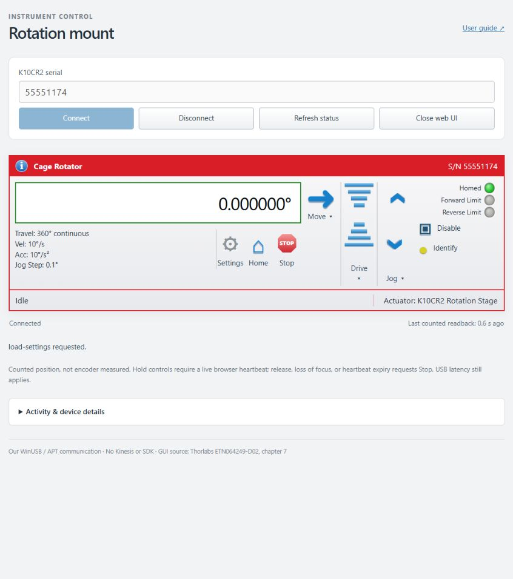
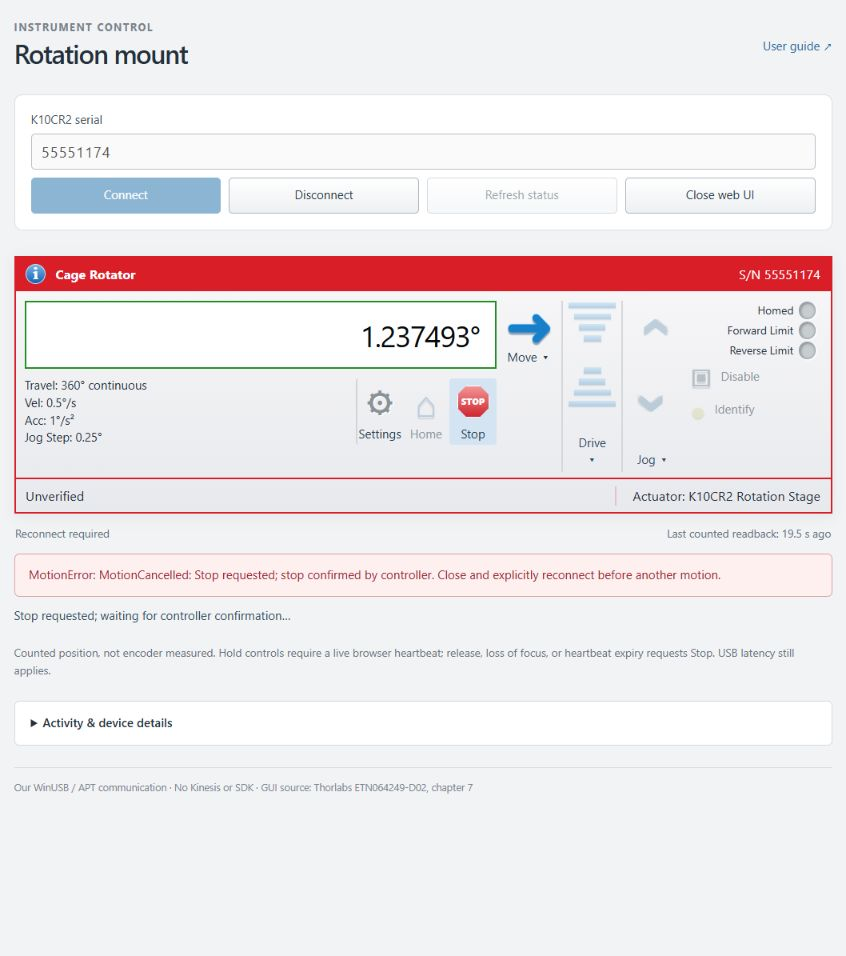

# Actual-mount GUI control test — 6 November 2026

**All requested controls passed after one narrowly scoped parser correction.**
Test window: approximately **15:14–15:22 CST** (UTC−06:00).
Unit: **K10CR2 serial 55551174, firmware 2.0.1, hardware revision 4**.

Actions were initiated through the implemented Dash GUI and its actual pointer,
button, settings and Stop callbacks. Hardware traffic used **our own
WinUSB/PyUSB/libusb/APT implementation exclusively**. No Kinesis application,
SDK, pythonnet, driver replacement, factory reset, trigger, or EEPROM command
was used. The capture process recorded no loaded `clr`, `pythonnet`, or `Thorlabs`
modules. A recording-only observer and an additional manual-motion duration/count
guard were added outside the product code; the guard never fired and did not
provide a second USB reader.

## Results

Angles are **controller counts converted to degrees**, not external angular
measurements. Durations run from the native motion packet to fresh stopped
status/position readback, including software polling. They are not mechanical
settling or certified stop-response measurements.

| GUI action | Counted start → end / ° | Duration / s | Evidence / result |
| --- | --- | ---: | --- |
| Home | 0 → 0 | 2.562 | Fresh homing transition, `0444`, zero position; **PASS** |
| Move to 1° | 0 → 0.999997559 | 2.563 | 136,533 counts; `0464`, fresh idle; **PASS** |
| Jog forward, 0.25° step | 0.999997559 → 1.249995117 | 1.063 | Native `046A`, +34,133 counts, `0464`; **PASS** |
| Jog reverse, 0.25° step | 1.249995117 → 0.999997559 | 1.110 | Native `046A`, −34,133 counts, `0464`; **PASS** |
| Hold Drive forward, then release | 0.999997559 → 1.195144043 | 0.656 | +0.195146484°, `0466`, fresh idle; **PASS** |
| Hold Drive reverse, then release | 1.195144043 → 1.011950684 | 0.656 | −0.183193359°, `0466`, fresh idle; **PASS** |
| Stop during Move toward 2.5° | 1.011950684 → 1.237492676 | 0.719 | Actual moving status observed; stopped before target; `0466`, fresh idle; **PASS** |
| Reconnect and Move back to 0° | 1.237492676 → 0 | 3.266 | `0464`, zero counts; **PASS** |
| Settings readback / verification | Five parameter groups | — | Velocity, jog, backlash, home, hardware buttons decoded successfully; **PASS** |

Every final motion readback was **`0x80000400`**: homed, enabled, neither moving
nor homing, no motion error. The explicit Stop produced the intended
`MotionError(MotionCancelled)` with **stop confirmed**, retained a known stopped
state, and blocked new motion until explicit disconnect/reconnect. This is an
expected cancelled operation, not a failed stop. There were three stop commands:
two Drive releases and the explicit Stop button.

Both Drive buttons were held for a requested 600 ms with session speed 0.5°/s.
As implemented, forward Drive sends the Fixed Range boundary target **360°** and
reverse Drive sends **0°**, then release causes a profiled stop through the same
owner. Actual traversed distances were below 0.20°. The extra bench guard would
request Stop after two seconds of manual operation or counts outside roughly
0–3°; it did not fire. The session plan's small-target note refers to the explicit
Move tests, not Drive's internal range-boundary target.

Home retained the original homing parameters (including a roughly 4° zero offset).
It is a datum-finding operation, not a limited incremental move. Fresh counted
samples during home reached approximately −1.7584° before ending at zero; this
sample range does not establish the complete mechanical homing trajectory.

## Temporary settings and exact restoration

The GUI applied and readback-verified a temporary **0.5°/s / 1°/s²** move profile,
**0.25°** single-step/profiled jog with the same speed/acceleration, and **zero
backlash compensation**. The jog step rounded to 34,133 counts (0.249997559°).
No EEPROM persistence was selected or transmitted. Home parameters and
hardware-button settings were not changed.

After returning to zero and disconnecting the GUI, a separate, sequential
connection using our same APT implementation restored the captured original
**raw** velocity, jog and backlash groups. It sent no motion or EEPROM command.
The GUI then reconnected and read all five groups again. **Every raw field matched
the original baseline exactly**, including unchanged home and hardware buttons.
Exact raw restoration avoids changing settings through floating-point conversion
or claiming a USB supply rating merely to restore pre-existing parameters.

Original raw values include move maximum velocity 73,300,775, acceleration 15,020;
jog maximum velocity 109,951,163, acceleration 22,530, step 13,653; backlash 136,533.
The legacy protocol scale currently displays the original move velocity as
10.00132144°/s and jog velocity as 15.00198223°/s. This test verifies protocol
acceptance and counter behavior, **not a calibration of those physical scales**.

Final controller state: **zero counts, homed, enabled, idle, no error**. The motor
enable/holding state matched its initial state. The GUI disconnected cleanly,
closed the USB connection and shut down the recording server.

## Firmware reply difference found and corrected

The initial read-only attempt failed on the first jog-parameter header:
`18 04 16 00 80 50`. The protocol's generic reply convention would use destination
`81`; this mount's firmware uses **`80` for `GET_JOGPARAMS` (`0418`)** while other
tested reply types use the normal host address. No motion or setting write had
been sent in that first session. The buffered rejected header required restarting
our own recording process to release that read-only connection; its failed
session is retained separately.

The parser now permits destination `80` **only for `0418`**, retaining exact
payload length, device-source `50`, and channel-1 checks. Other reply types do not
gain zero-host acceptance. The complete actual reply is saved as a regression
fixture and exercises the real query/decode path offline. This is a documented
observed firmware exception, not a claim that the generic protocol specifies it.

One host-only Apply request was refused while an idle background refresh owned
the worker; the GUI displayed a wait message. Reapplying succeeded. No unwanted
motion or device write occurred from that refused request.

## Evidence

- [Structured results and raw-setting comparison](gui-controls-20261106-211627Z-summary.json)
- [Full GUI requests, state transitions and APT chunks](gui-controls-20261106-211627Z.jsonl)
- [Raw APT traffic log](gui-controls-20261106-211627Z.log)
- [Reassembled native frames](gui-controls-20261106-211627Z-frames.json)
- [Original baseline](gui-controls-20261106-211627Z-baseline.json)
- [Exact restoration results](gui-controls-20261106-211627Z-restore.json) and
  [restoration raw traffic](gui-controls-20261106-211627Z-restore.log)
- [Final GUI readbacks](gui-controls-20261106-211627Z-final-gui.json)
- [Initial rejected-header session](gui-controls-20261106-211439Z.jsonl) and
  [its raw traffic](gui-controls-20261106-211439Z.log)
- [Actual jog-parameter fixture](../../tests/fixtures/gui-jog-settings-host-zero-20261106.hex)

## Limits

Post-bench software checks passed **191 tests**, Ruff lint/format checks, and
wheel/source-distribution builds. The built wheel contains the parser correction
and manufacturer manual. All product-source hashes recorded at session start
still matched the tested files at final verification.

This covers one unit and firmware version under the recorded conditions. It does
not validate external angular accuracy, optical safety, load-dependent settling,
hard real-time stopping, USB disconnect/sleep faults, continuous-jog mode,
held-jog repetition, every Drive speed, EEPROM retention, hardware-button writes,
enable/disable, Identify's visible LED, or unavailable GUI functions. No Kinesis
or SDK access is needed or authorized by these results.
