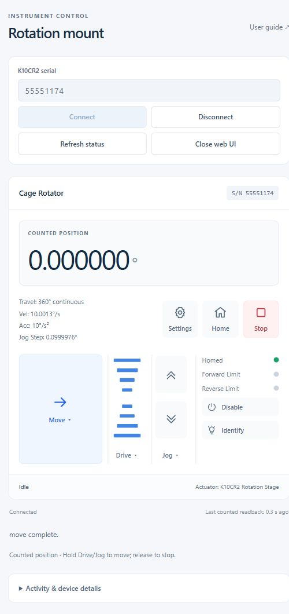

# Migrated GUI: actual-mount acceptance — 6 November 2026

**Fixed, Total and Equivalent modes, Jog, Drive, Stop and all five settings
readbacks passed on the actual mount. Two defects were found, fixed and retested.**

Unit: **K10CR2 serial 55551174, firmware 2.0.1, hardware revision 4**.
Recorded test windows: **17:08–17:17 CST**, plus the restored-profile regression
check at **17:24 CST** (UTC−06:00). All actions used the production web UI and our
WinUSB/PyUSB/libusb/APT implementation. No Kinesis, SDK, driver replacement,
firmware or EEPROM command was used. Recording/restoration processes reported no
loaded `clr`, `pythonnet`, `Thorlabs` or `Kinesis` module.

## Conditions and method

The initial state was zero counts, homed, enabled and idle. No new Home command was
required or sent. The GUI captured all five settings groups before any write.
Temporary volatile parameters were **0.5°/s, 1°/s²**, a **0.25° single-step/profiled
jog**, zero backlash compensation, and a session-only 0.5°/s first Drive division.
No USB supply rating was asserted to permit higher speeds.

Every actuator action came through GUI buttons/pointer events; no second reader
owned USB. The bench recorder observed traffic, fresh readbacks and operation
boundaries. It added counted-travel (±3°) and manual-duration (2 s) Stop guards;
**neither guard fired**. They are software guards subject to query/USB latency,
not independent physical interlocks. Native Drive retains its finite counted-range
boundary target (±15,480° in Equivalent mode); 600 ms holds and normal release
stopped actual counted travel below 0.20°.

Values below are controller counts converted using 49,152,000 counts/revolution,
not externally measured angles. Durations cover the GUI owner's operation,
including preflight, polling and any profile read/restore. They are not independent
mechanical settling or certified stop-response times.

## Counted results

| Code/check | Start → end counts | End / ° | Duration / s | Evidence |
| --- | ---: | ---: | ---: | --- |
| Initial Fixed move to 0.5° | 0 → 68,267 | 0.500002441 | 1.547 | `0453`, `0464`, fresh idle |
| Initial Total move to −0.5° | 68,267 → −68,267 | −0.500002441 | 2.718 | Signed target/counter, `0464` |
| Fixed return after routing fix | 6,357 → 0 | 0 | 0.500 | Fresh idle and zero |
| Total to −0.25°, after routing fix | 0 → −34,133 | −0.249997559 | 1.125 | Negative count target, `0464` |
| Equivalent quickest to 0.25° | −34,133 → 34,133 | 0.249997559 | 1.563 | Short route through zero, `0464` |
| Equivalent reverse, repeat 0.25° | 34,133 → 34,133 | 0.249997559 | 0.032 | **No motion packet**, fresh status/position |
| Equivalent reverse to 359.75° | 34,133 → −34,133 | −0.249997559 | 1.672 | Small negative move; display 359.750002° |
| Equivalent forward, repeat 359.75° | −34,133 → −34,133 | −0.249997559 | 0.016 | **No motion packet**, fresh status/position |
| Equivalent forward to 0° | −34,133 → 0 | 0 | 1.078 | Small positive move, `0464` |
| Jog forward, single click | 0 → 34,133 | 0.249997559 | 1.078 | Native `046A`; `0464` |
| Jog reverse, single click | 34,133 → 0 | 0 | 1.125 | Native `046A`; `0464` |
| Drive forward, hold/release | 0 → 26,623 | 0.194992676 | 0.672 | `0466`, fresh idle, temporary profile restored |
| Drive reverse, hold/release | 26,623 → 676 | 0.004951172 | 0.687 | `0466`, fresh idle, temporary profile restored |
| Stop during move toward 2° | 676 → 6,357 | 0.046560059 | 0.328 | Moving observed; one Stop; `0466`; stopped before target |
| Restored-profile Move to current zero | 0 → 0 | 0 | 0.015 | **No motion, profile-write or EEPROM packet** |

The initial session also verified all three ordinary Equivalent routes; its full
results are in the summary. Jog, Drive and interrupted Stop were recorded before
the resolver correction; their controller/owner implementations were unchanged.
Fixed/Total/Equivalent and both repeated-phase cases were retested with the
corrected resolver. The final session checked the GUI profile fix with the exact
original device settings restored.

All finished operations reported **`0x80000400`**, homed, enabled and idle. The
explicit Stop intentionally produced `MotionError(MotionCancelled)`, **stop
confirmed**, a known stopped state and the required reconnect. This was expected
cancellation, not failed cleanup. The observed counted range across the movement
sessions was only **−0.500002441° to +0.500002441°**; no full revolution was sent
for the repeated-phase defect or physically attempted.

## Issues fixed

1. **A repeated quantized Equivalent target could add a revolution.** The original
   degree-space resolver compared a requested 0.25° with the actual 34,133-count
   angle (0.249997559°). Forced reverse could select another full turn despite the
   target already being reached at count resolution. The defect was reproduced
   offline, not by commanding that revolution. Commit **`ee4b3ea`** resolves phase
   and direction in integer counter counts. Both forced-direction regressions
   passed on the mount with unchanged counters and no `0453` packet.
2. **Move implicitly reapplied an unedited loaded profile.** With the original
   velocity readback displayed as 10.00132144°/s under the protocol's approximate
   scale, even Move to the current zero failed nominal 10°/s setting validation.
   The failure was reproduced in the GUI without movement. Commit **`4c526ef`**
   preserves unedited/blank profiles; genuinely edited profiles and explicit Apply
   still go through existing write validation. The restored-profile zero Move now
   succeeds using status/position queries only. No scale constant or supply
   confirmation requirement was weakened to make the test pass.

## Exact restoration and final state

After return to zero and GUI disconnect, one sequential connection through our
same controller restored only the raw velocity, jog and backlash values captured
before testing. It used the existing setter/readback path without floating-point
display conversion. Home and hardware-button groups were checked unchanged.
The restoration trace contains **no motion, enable/disable or EEPROM packet**.

All five raw groups exactly match the initial baseline, including the original
move velocity 73,300,775, jog velocity 109,951,163, jog step 13,653 and backlash
136,533. The normal corrected GUI was restarted and left connected at **zero
counts, homed, enabled, idle and error-free**. Session defaults were restored by
that normal restart.

## Evidence and validation

- [Structured results, source hashes, raw packet counts and all operations](gui-migration-20261106-231335Z-summary.json)
- [Initial baseline](gui-migration-20261106-230830Z-baseline.json)
- Initial session: [GUI/readback/APT journal](gui-migration-20261106-230830Z.jsonl), [APT log](gui-migration-20261106-230830Z.log)
- Routing-fix retest: [journal](gui-migration-20261106-231335Z.jsonl), [APT log](gui-migration-20261106-231335Z.log), [test-end state](gui-migration-20261106-231335Z-test-end.json)
- Profile-fix retest: [journal](gui-migration-20261106-232359Z.jsonl), [APT log](gui-migration-20261106-232359Z.log), [restored final GUI state](gui-migration-20261106-232359Z-final-gui.json)
- [Exact raw restoration](gui-migration-20261106-231335Z-restore.json), [restoration APT log](gui-migration-20261106-231335Z-restore.log)
- [Total display](gui-migration-20261106-230830Z-total.jpg), [Equivalent display](gui-migration-20261106-230830Z-equivalent.jpg), [Stop result](gui-migration-20261106-230830Z-stop.jpg), [original profile error](gui-migration-20261106-231335Z-profile-error.jpg)
- [Artifact SHA256 manifest](gui-migration-20261106-231335Z-manifest.json)
- Bench tooling: [recorder](../../tools/bench/record_gui.py), [raw restoration](../../tools/bench/restore_raw_settings.py)

**282 offline tests passed**, with Ruff lint/format checks. New tests cover repeated
quantized phases across positive/negative turns and every direction, actual literal
counter no-op traffic, counted bounds/ties, and unchanged versus edited GUI profiles.
All APT receive chunks were reassembled offline; framing, address, length and
channel checks passed with no partial tail. All three recording sessions shut down
cleanly and reported no forbidden module. Final-session source hashes still match
the tested working files.

This validates one unit and firmware version under these small-move conditions.
Independent angular/rate calibration, full-turn and multi-turn physical travel,
continuous/held-repeat jog, every Drive division, emergency USB failure/sleep,
power-cycle EEPROM retention, physical button actions, enable/disable, optical
Identify feedback and unavailable mappings remain outside this test.

